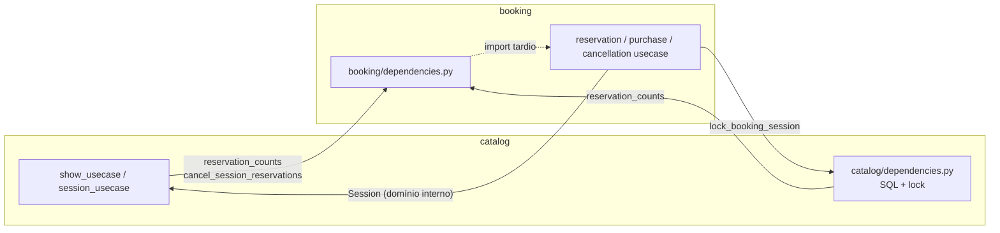

# Relatório da N3: o Ludens volta para a equipe de origem

Grupo 18 · Manutenção e Melhoria de Software · Plataforma Ludens (venda de
ingressos para teatro comunitário).

O Ludens foi construído por nós na N1 (repositórios `gcarvalhow/api.ludens`,
`gcarvalhow/web.ludens` e `gcarvalhow/docs.ludens`). Na N2 ele foi mantido pela
equipe **CodePenguinsCorp**, que trabalhou em forks
(`CodePenguinsCorp/api.ludens`, `web.ludens` e `docs.ludens`) enquanto nós
mantínhamos o SREC. Este relatório cobre as sete etapas pedidas para a N3.

A regra adotada em todo o documento: **cada afirmação traz o número e o comando
que a produziu**. Onde algo não pôde ser medido, isso está dito explicitamente.

## Sumário executivo

* A N2 entregou o que faltava do núcleo do produto: reserva (RF03), compra e
  emissão de ingresso em modo **simulado** (RF04, RF05), histórico (RF06),
  cancelamento com reembolso simulado (RF07), além do autosserviço da conta.
* **Nenhuma regressão funcional encontrada.** Os 57 testes do N1 continuam
  intactos e verdes sobre o código da N2, as 31 rotas do N1 continuam
  publicadas com o mesmo caminho e a nova suíte HTTP de regressão (8 testes)
  passa.
* A N2 corrigiu **3 defeitos do N1** que nós não tínhamos detectado (senha
  acima de 72 bytes derrubava a API com erro 500; o deploy do frontend
  executava código de PR com o token da Vercel; condições de corrida na confirmação de
  troca de e-mail e exclusão de conta, provadas por 5 testes que falham no
  código do N1).
* O preço foi **erosão de arquitetura e de processo**: dependência circular
  entre `catalog` e `booking`, SQL dentro da camada `application`, funções
  longas (3 para 9 acima de 30 linhas), 0 issues abertas, 9 de 11 PRs sem
  descrição e 7 commits direto na `master`.
* O sistema **não está pronto para produção**: o pagamento é simulado, a
  infraestrutura aponta para a organização da outra equipe e o outbox não tem
  tratamento de falha permanente. O plano de refatoração (etapa 7) ataca isso em
  quatro fases.

## Como medimos

Todas as medições foram feitas sobre três versões congeladas:

| Versão | Repositório e commit | O que representa |
| --- | --- | --- |
| N1 | `gcarvalhow/api.ludens@81acf55`, `web.ludens@7fc0c3e`, `docs.ludens@367ee5b` | o que entregamos |
| N2 | `CodePenguinsCorp/api.ludens@0a38144`, `web.ludens@5f159c6`, `docs.ludens@3907a99` | o que recebemos de volta |
| N3 | `gcarvalhow/api.ludens` com a N2 integrada por fast-forward (local) | N2 integrada + testes novos da N3 |

Ambiente: Python 3.12, PostgreSQL 16 local na porta 5433 (o mesmo banco
`ludens_test` que o `docker-compose.Staging.yml` sobe), Node 22.

```bash
# backend: testes e cobertura sobre TODO src/app (inclui arquivo nunca importado)
pytest -q --cov=src/app --cov-report=term
# backend: diferença entre models e migrations
alembic upgrade head && alembic check
# backend: duplicação e complexidade
pylint --disable=all --enable=duplicate-code --min-similarity-lines=4 app
radon cc -s -n C src/app
# frontend
npx tsc --noEmit && npx eslint . && npx jest --coverage --collectCoverageFrom='src/**/*.{ts,tsx}'
```

O `--collectCoverageFrom` do Jest é obrigatório: sem ele a cobertura conta só os
arquivos importados por algum teste e infla o número (o N2 reporta 88,49 % por
esse critério, contra 31,54 % sobre todo o código-fonte).

Integração: os forks da N2 partem exatamente do último commit do N1 nos três
repositórios, então a N2 entra no nosso repositório por **fast-forward**, sem
conflito. Os PRs que a N2 abriu contra o nosso repositório
([gcarvalhow/api.ludens#68](https://github.com/gcarvalhow/api.ludens/pull/68) e
[gcarvalhow/api.ludens#69](https://github.com/gcarvalhow/api.ludens/pull/69))
foram fechados minutos depois, sem merge, e o trabalho seguiu nos forks.

## Etapa 1. Redefinição do perfil de cada integrante

A disciplina prevê rodízio: ninguém repete um papel que já exerceu. Partimos do
histórico registrado em `docs.ludens/team/overview.md` (N1) e
`srec/docs/time/overview.md` (N2).

| Pessoa | N1 (Ludens) | N2 (SREC) | **N3 (Ludens)** |
| --- | --- | --- | --- |
| Igor Thiago Seberino | Desenvolvedor Backend | Product Owner + QA | **DevOps** |
| Gabriel Carvalho | Product Owner + DevOps | DevOps | **Desenvolvedor Full-stack** |
| Adrian Cesar Gonçalves | Quality Assurance | Desenvolvedor Backend | **Engenheiro de Requisitos** |
| Renato Colin Neto | Engenheiro de Requisitos | Desenvolvedor Frontend | **Quality Assurance** |
| Diego Nessler | Desenvolvedor Frontend | Engenheiro de Requisitos | **Product Owner** |

Os cinco papéis da N3 são inéditos para quem os assume, e cada pessoa tem um
papel só (na N2 o Igor acumulou PO e QA, o que gerou conflito de interesse
registrado na época).

Por que essa distribuição:

* **Igor (DevOps).** A maior parte do risco de produção encontrado é de
  infraestrutura (DT-05, DT-06, DT-07, DT-14). É o papel que ele ainda não
  exerceu e o que destrava o deploy.
* **Gabriel (Full-stack).** Escreveu boa parte do código do N1, mas formalmente
  foi PO e DevOps. Na N3 ele executa a refatoração (etapa 7) e mantém os testes
  novos; como a N2 tocou backend e frontend juntos em cada feature, um papel
  único de desenvolvimento evita dividir a mesma fatia entre duas pessoas.
* **Adrian (Engenheiro de Requisitos).** Dono das etapas 2 e 3: confrontar a
  documentação da N2 com o código e atualizar o estado de cada RF.
* **Renato (QA).** Dono das etapas 4, 5 e 6: verificar o que foi aplicado,
  regressão e padrões, e aprovar todos os PRs da N3. Ele não escreveu o backend
  nem o código da N2, então revisa sem viés de autoria.
* **Diego (PO).** Papel de menor volume técnico nesta entrega: prioriza a lista
  de débitos (etapa 7) a partir do que os outros levantaram, decide o que entra
  no plano e aceita a entrega do relatório. Não depende de ambiente local nem de
  conhecer o código a fundo.

Matriz RACI da N3 (R executa, A aprova, C é consultado, I é informado):

| Atividade | Igor (DevOps) | Gabriel (Dev) | Adrian (Req) | Renato (QA) | Diego (PO) |
| --- | --- | --- | --- | --- | --- |
| Analisar a documentação da N2 (etapas 2 e 3) | I | C | **R** | C | A |
| Verificar o que foi aplicado e os padrões (etapas 4 e 5) | C | C | C | **R** | A |
| Atualizar os testes (etapa 6) | C | **R** | I | A | I |
| Reintegrar CI, infraestrutura e deploy | **R** | C | I | C | A |
| Priorizar débitos e plano de refatoração (etapa 7) | C | C | C | C | **R/A** |
| Consolidar e entregar o relatório | C | C | C | C | **R/A** |

## Etapa 2. Análise da documentação da equipe anterior

A N2 alterou 15 arquivos em `docs.ludens` (+643/−49 linhas, `git diff --stat
367ee5b master`) e 2 READMEs de código.

O que está bom:

* **Contratos novos documentados.** `specs/booking-reservation/integration.md`
  e `specs/payment-pix-checkout/integration.md` listam rotas, payloads, estados
  e regras de idempotência, e batem com o OpenAPI gerado pelo código (13 rotas
  novas, conferidas uma a uma).
* **Desvio de escopo declarado.** A spec de pagamento ganhou um aviso de que a
  versão implementada é demonstrativa, sem Pix nem gateway. A decisão está
  escrita, não escondida.
* **Débito do N1 conferido contra o código.** Em `team/overview.md` a N2
  registrou que o débito de prefixo de rotas do frontend "não está aberto no
  código atual". Conferimos: o frontend do N1 já usava `/api/identity/...`
  desde o commit `2df3654` (18/09). O nosso documento de handoff estava
  desatualizado, e a N2 corrigiu isso.
* **Guia de operação.** `team/local-api-vercel.md` e
  `team/infra-codepenguins.md` explicam como subir o ambiente da N2, inclusive
  as pendências (migrations não rodam no pipeline, referências de workflow não
  fixadas em SHA).

O que está errado ou faltando:

* **Cancelamento sem documentação.** O PR de cancelamento (o maior de lógica,
  `cancellation_usecase.py` com 207 linhas, check-in e listagem de pedidos para
  administrador) **não tem PR em `docs.ludens`**. `specs/payment-cancellation-refund/`
  continua com o texto de planejamento do N1.
* **Documento que se contradiz no mesmo dia.** `buyer-account.md` diz que
  "reservas ainda não têm módulo implementado"; o módulo entrou menos de
  uma hora depois (PR #2) e o texto não foi revisto. O mesmo ocorre em
  `booking-reservation/integration.md`, que diz não haver endpoint público de
  confirmação, quando o PR #3 criou `POST /api/booking/orders/{id}/simulate`.
* **Estado das specs não atualizado.** As cinco specs implementadas na N2
  continuam com `status: approved` no frontmatter; a convenção de
  `specs/README.md` pede `in-progress` ou `done`.
* **Links frágeis.** O README de `api.ludens` aponta para um branch
  (`blob/feat/buyer-account-management/...`) e para a organização da N2, não
  para o repositório canônico.
* **Artefato de ferramenta versionado.** `docs/superpowers/plans/` e
  `docs/superpowers/specs/` são o registro de execução de um assistente de IA
  (ledger com "Ruling", "Task 1..4"). Não seguem a convenção de pastas e
  duplicam o conteúdo de `team/local-api-vercel.md`.

## Etapa 3. Manutenções e melhorias identificadas pela equipe anterior

A N2 **não produziu um relatório de auditoria** nem abriu issues: a busca em
issues dos três forks retorna 0 resultados
(`gh api search/issues -f q='repo:CodePenguinsCorp/<repo> is:issue'`). As
manutenções propostas aparecem espalhadas em descrições de PR, em
`team/infra-codepenguins.md` e no ledger de `docs/superpowers/`. Consolidamos
abaixo, junto com os dois débitos que nós deixamos no handoff do N1.

Débitos deixados pelo N1 (`docs.ludens/team/overview.md`, seção "Débitos
conhecidos hoje"):

* Frontend desalinhado do contrato de `identity` (impacto alto).
* Frontend sem as páginas de confirmação por e-mail (troca de e-mail e
  exclusão de conta; impacto alto).

Manutenções e melhorias propostas pela N2:

* Adaptar CI, deploy e Terraform para a organização da N2.
* Ambiente de demonstração local com túnel HTTPS para o frontend na Vercel.
* Autosserviço completo da conta, com confirmações protegidas contra
  concorrência.
* Restringir o deploy a push aprovado na `master`.
* Limitar senha a 72 bytes (limite do bcrypt).
* Pendências declaradas por eles mesmos: rodar migrations no pipeline, fixar
  workflows reutilizáveis em SHA revisado, teste de proxy sem herdar variável de
  ambiente, teste unitário de logout.
* Pagamento e reembolso reais declarados fora desta versão.

## Etapa 4. As manutenções e melhorias foram aplicadas?

| Item | Origem | Situação | Evidência |
| --- | --- | --- | --- |
| Frontend alinhado ao contrato de `identity` | N1 | **aplicado antes da N2** | `web.ludens@7fc0c3e:src/routes/endpoints.ts` já usa `/api/identity/...`; o documento estava atrasado |
| Páginas de confirmação por e-mail | N1 | **aplicado** | `src/app/confirmar-troca-de-email/` e `confirmar-exclusao-de-conta/`, com 82 linhas de teste em `AccountConfirmation.test.tsx` |
| CI, deploy e Terraform na organização da N2 | N2 | **aplicado** | `ci.yml`, `deploy.yml`, `terraform/variables.tf`; ver DT-05 para o efeito na reintegração |
| Ambiente demo com túnel | N2 | **aplicado** | `docker/docker-compose.Demo.yml`, `scripts/Start-Demo.ps1` |
| Autosserviço da conta e concorrência | N2 | **aplicado e testado** | 20 casos de teste em `test_account_concurrency.py` e `test_buyer_account.py`; 5 dos 6 de concorrência falham no código do N1 |
| Deploy só em push aprovado na `master` | N2 | **aplicado** | condição `workflow_run.event == 'push'` e `head_branch == 'master'` em `web.ludens/.github/workflows/deploy.yml` |
| Senha limitada a 72 bytes | N2 | **aplicado e testado** | `PasswordService.hash` e `tests/unit/test_password_length.py` |
| Migrations automáticas no pipeline | N2 | **não aplicado** | o próprio guia diz que "o workflow atual não executa migrations" |
| Workflows reutilizáveis fixados em SHA | N2 | **não aplicado** | `ci.yml` e `deploy.yml` usam `CodePenguinsCorp/pipelines.ludens/...@master` |
| Teste de proxy isolado de variável de ambiente | N2 | **não aplicado** | marcado como "minor (deferred)" no ledger |
| Teste unitário de logout | N2 | **aplicado na N3** | `test_logout_clears_cookie_and_revokes_refresh` (este relatório, etapa 6) |
| Pagamento Pix e reembolso real | N2 | **adiado por decisão** | `payment-pix-checkout/spec.md`, aviso de "Implementação vigente" |

Resultado: dos 12 itens, 8 aplicados (1 deles já estava resolvido antes da
N2), 1 aplicado por nós na N3, 2 não aplicados e 1 adiado por decisão
declarada.

Estado dos requisitos funcionais depois da N2:

| RF | Descrição | Situação |
| --- | --- | --- |
| RF01 | Buscar e filtrar espetáculos | implementado (N1) |
| RF02 | Detalhe da sessão | implementado (N1); disponibilidade passou a ser real na N2 |
| RF03 | Reservar ingressos (RN01, RN03, RN05) | implementado (N2), com teste de concorrência para venda acima da capacidade |
| RF04 | Pagamento | implementado com defeito de escopo: **simulado**, sem Pix nem AbacatePay |
| RF05 | Confirmar compra e emitir ingresso (RN04) | implementado em modo demonstrativo; e-mail via outbox |
| RF06 | Histórico de compras | implementado (N2) |
| RF07 | Cancelamento e reembolso (RN02) | implementado com reembolso **simulado** |
| RF08 | Gestão de espetáculos e sessões | implementado (N1); cancelamento em cascata, pedidos e check-in na N2 |
| RF09 | Cadastro e autenticação | implementado (N1); autosserviço completo na N2 |
| fora do RF | Convite de administrador (`identity-admin-invite`) | não implementado |

## Etapa 5. Padrões, duplicação e regressão

### Volume e qualidade medidos

| Métrica (backend `src/app`) | N1 | N2 | Variação |
| --- | --- | --- | --- |
| Linhas de código (sem branco e comentário) | 2.479 | 3.688 | +48,8 % |
| Rotas HTTP publicadas | 31 | 44 | +13, nenhuma removida |
| Testes coletados (`pytest`) | 57 | 121 | +64 |
| Cobertura de statements | 63,9 % (1.179/1.844) | 87,2 % (2.428/2.786) | +23,3 p.p. |
| Funções com mais de 30 linhas (limite do guia de estilo) | 3 | 9 | +6, todas em `booking` |
| Funções com complexidade ciclomática C ou pior (`radon`) | 1 | 5 | +4, todas em `booking` |
| Blocos duplicados de 4+ linhas (`pylint` R0801) | 5 | 7 | +2 |
| Arquivos com linha em branco dupla (proibido pelo guia) | 0 | 16 | +16 |
| Imports de submódulo `app.core.domain.errors` (guia manda importar do pacote) | 3 | 8 | +5 |
| `select(` dentro de `application/` | 0 | 24 | +24 |
| Operações de diferença entre models e migrations (`alembic check`) | 4 | 2 | −2 |

| Métrica (frontend) | N1 | N2 |
| --- | --- | --- |
| `tsc --noEmit` | sem erro | sem erro |
| `eslint` | 0 erros, 3 avisos | 0 erros, 3 avisos (os mesmos) |
| Testes Jest | 34 (3 suítes) | 93 (14 suítes) + 1 suíte Playwright no CI |
| Cobertura sobre todo `src/` | 6,38 % (78/1.221) | 31,54 % (623/1.975) |

A N2 escreveu mais teste do que código novo justifica: a cobertura subiu nos
dois lados. O problema não está na quantidade de teste, e sim na estrutura do
código novo.

### Desvios dos padrões iniciais

Os padrões de referência são `docs.ludens/backend/conventions.md`,
`backend/code-style.md` e o README de `api.ludens` ("nenhum módulo importa o
interno de outro").

* **Fronteira entre módulos violada e ciclo de dependência.** `booking`
  importa o agregado `Session` de `catalog.domain` e `User` de
  `identity.domain` em 3 arquivos de `application/` (4 imports). Ao mesmo
  tempo `catalog` importa `booking.dependencies` em 3 arquivos, e
  `booking.dependencies` só funciona com um import tardio dentro da função,
  com o comentário "the cancellation use case depends on catalog, which imports
  this module". É um ciclo contornado, não resolvido.



* **SQL na camada errada.** O guia diz que código que toca o banco fica em
  `infrastructure/`. Os três usecases de `booking` fazem 24 `select(...)` e 15
  `with_for_update()` diretamente; no N1 o número era 0. `catalog/dependencies.py`
  também roda SQL fora de `infrastructure/`.
* **Agregado anêmico e outbox escrito à mão.** `Reservation` segue o padrão do
  N1 (`raise_event`), mas `PaymentOrder` e `Ticket` herdam só `Model` e têm o
  estado alterado pelo usecase (`order.status = OrderStatus.CANCELLED`). Os
  eventos `OrderPaid` e `OrderCancelled` são inseridos com `db.add(Event(...))`
  em 3 lugares, contornando o `AggregateRepository`.
* **Módulo `payment` não criado.** A arquitetura prevê cinco módulos; pedido e
  pagamento foram parar dentro de `booking`.
* **Estrutura de pastas diferente do resto.** `booking` usa `router.py` com
  dois routers no mesmo arquivo e usecases soltos em `application/`, enquanto
  `identity` e `catalog` usam `api/routers/`, `application/usecases/`,
  `domain/aggregates/` e `infrastructure/repositories/`.
* **Regras de contrato REST.** `GET /api/booking/admin/orders` usa `/admin`
  como segmento de URL, o que o guia proíbe. A checagem de papel de
  administrador foi feita dentro do usecase (`if is_admin: raise
  ForbiddenError`), quando o guia manda fazer no router. `POST
  /reservations/{id}/cancel` chama `get(..., cancel=True)`, um parâmetro
  booleano que muda o comportamento do método.
* **Usecase chamando método privado de outro.** `CancellationUseCase` chama
  `self._purchases._owned_order`, `_response` e `_now` de `PurchaseUseCase`.
* **Frontend.** `src/lib/fetcher.ts` (genérico) passou a importar
  `@account/lib/navigation` (feature), invertendo a direção da dependência.
* **Processo.** 0 issues nos três forks; 9 de 11 PRs sem descrição (6 com o
  template em branco, 3 com corpo vazio); 7 commits direto na `master`
  (2 em `api`, 3 em `web`, 2 em `docs`); 4 mensagens de commit em inglês contra
  a convenção de português no imperativo; 1 commit cujo título é o nome do
  branch. Os 11 PRs de feature foram criados e mergeados em 23/10, entre 16h40
  e 19h20.

### Código duplicado

* **Teste triplicado.** `test_cancelling_reservation_closes_its_pending_order`
  aparecia **três vezes, idêntico**, em `test_reservations.py` (linhas 404, 430
  e 439). O Python mantém só a última definição, então duas cópias nunca
  rodavam (`ruff --select F811` acusa 2 redefinições). Corrigido na N3.
* **Tipo `Reservation` definido duas vezes no frontend**, com formatos
  diferentes: à mão em `features/booking/server/types.ts` e inferido do zod em
  `features/booking/server/types/reservation.types.ts`. Componentes diferentes
  usam um ou outro. É o rastro de dois PRs feitos em paralelo e mergeados sem
  integração.
* **`find_by_token_hash_for_update`** idêntico em
  `email_change_token_repository.py` e `account_deletion_token_repository.py`
  (9 linhas, apontado pelo `pylint`).
* **Busca de pedido com lock** repetida em `cancellation_usecase.py` e
  `purchase_usecase.py`.
* **`response.headers["Cache-Control"] = "no-store"`** repetido nos 13
  handlers de `booking/router.py`, quando uma dependência ou middleware resolve
  uma vez.

### Regressão

Pergunta: alguma funcionalidade que existia no N1 deixou de funcionar?

* **Testes do N1.** Nenhum arquivo de teste do N1 foi apagado ou alterado
  (`git diff --diff-filter=DM 81acf55 master -- tests` mostra só o
  `conftest.py`, que ganhou proteção contra apagar banco errado). Os 57 testes
  do N1 passam sobre o código da N2.
* **Contrato HTTP.** As 31 rotas do N1 continuam publicadas com o mesmo método
  e caminho (comparação do `app.openapi()` das duas versões).
* **Frontend.** Os 3 arquivos de teste do N1 continuam lá (1 deles ganhou
  casos novos) e passam; `tsc` e `eslint` sem erro novo.
* **Suíte HTTP de regressão da N3.** 8 testes novos exercitam o fluxo de
  autenticação do N1 por HTTP depois da mudança no cookie de refresh: todos
  passam.

**Nenhuma regressão funcional encontrada.** Duas mudanças de comportamento são
intencionais e agora estão cobertas por teste: a exclusão de sessão ou
espetáculo passa a ser bloqueada quando há ingresso vendido (no N1 a contagem
era `SeatCounts(0, 0)` fixo e a trava nunca disparava) e o cancelamento de
sessão passa a cancelar os pedidos pagos.

Existe, porém, um **risco de regressão de infraestrutura na reintegração**
(DT-05): se o código da N2 for para a nossa `master` como está, o CI passa a
depender de `CodePenguinsCorp/pipelines.ludens@master` e os nomes padrão do
Terraform mudam (`rg-ludens-production` virou
`rg-codepenguins-ludens-production`, e o mesmo com App Service e PostgreSQL).
Pela nossa leitura do provedor `azurerm`, troca de nome de recurso força
substituição, o que recriaria banco e aplicação. **Não executamos `terraform
plan`** (não temos as credenciais Azure nesta análise); é a primeira coisa que o
DevOps precisa confirmar.

Defeitos do N1 que a N2 corrigiu, conferidos por nós:

* **Senha acima de 72 bytes derrubava a API.** No código do N1, com bcrypt
  5.0.0 instalado, `PasswordService().hash("a" * 73)` lança `ValueError`, que
  vira erro 500. A N2 transformou em erro de domínio (422).
* **Código de PR executado com segredo de deploy.** O `deploy.yml` do frontend
  no N1 rodava depois de qualquer CI verde, inclusive de PR, fazia checkout do
  `head_sha` do PR e executava `vercel build` com o `VERCEL_TOKEN` no ambiente
  (gerando deploy de preview). Pelo nosso entendimento da documentação do
  GitHub Actions, `workflow_run` também dispara para CI de PR vindo de fork, o
  que deixaria código de terceiros rodar com o segredo. A N2 restringiu o
  deploy a push na `master` do próprio repositório. Não reproduzimos o ataque;
  a conclusão vem da leitura do workflow.
* **Concorrência na confirmação de conta.** Rodamos os testes de concorrência
  da N2 (`test_account_concurrency.py`) sobre o código do N1: **5 de 6
  falham por asserção**. O mesmo token de confirmação é aceito duas vezes
  (`['confirmed', 'confirmed']` onde o esperado era um sucesso e um erro), dois
  links de confirmação ficam válidos ao mesmo tempo e dois administradores
  conseguem excluir juntos o último administrador ativo. Sobre o código da N2
  os 6 passam.

## Etapa 6. Testes atualizados para os novos cenários

Os testes novos foram escritos e executados sobre o código da N2 integrado
por fast-forward ao `api.ludens`. Eles ainda não foram publicados no
repositório: entram junto com o PR de reintegração da Fase 0 (etapa 7).

| Arquivo | Testes | Cenário |
| --- | --- | --- |
| `tests/integration/modules/identity/api/test_auth_http_regression.py` | 8 | Regressão do N1 por HTTP: cadastro com cookie `HttpOnly` e `Path` correto, 409 em duplicidade, 401 em senha errada, refresh com rotação e rejeição do token antigo, logout que revoga, permissão de perfil (dono 200, outro 403, anônimo 401), recuperação de senha sem revelar se a conta existe |
| `tests/integration/modules/catalog/application/test_session_usecase_with_booking.py` | 5 | Integração `catalog` e `booking`: visão admin com vendidos e reservados, disponibilidade pública, exclusão de sessão bloqueada com ingresso pago, exclusão de sessão que cancela reserva aberta, exclusão de espetáculo bloqueada |
| `tests/unit/modules/notification/test_booking_email_handlers.py` | 5 | E-mails da N2: registro dos handlers no outbox, e-mail de pedido pago com todos os códigos e HTML escapado, assunto de cancelamento por comprador e por sessão, cancelamento sem e-mail ignorado |
| `tests/unit/test_module_boundaries.py` | 1 + 2 xfail | Fronteira entre módulos: os módulos do N1 não importam interno de outro (passa); `booking` sem import interno e grafo sem ciclo (falham hoje, marcados `xfail(strict=True)` apontando para DT-01) |
| `tests/integration/modules/booking/test_reservations.py` | −2 | Remoção das duas cópias sombreadas do teste triplicado |

O `xfail(strict=True)` foi escolhido de propósito: o teste documenta o débito
sem quebrar o CI e **passa a falhar no dia em que o débito for resolvido**,
obrigando quem refatorar a remover a marcação.

| Métrica | N2 recebida | N3 | Comando |
| --- | --- | --- | --- |
| Testes que passam | 121 | **140** (+2 xfail esperados) | `pytest -q` |
| Cobertura de statements | 87,2 % (358 sem cobertura) | **88,9 %** (309 sem cobertura) | `pytest --cov=src/app` |
| `auth_router.py` | 70 % | 82 % | idem |
| `auth_usecase.py` | 46 % | 60 % | idem |
| `session_usecase.py` | 66 % | 75 % | idem |
| `notification/handlers.py` | 48 % | 67 % | idem |
| Redefinição de teste (`ruff F811`) | 2 | 0 | `ruff check --select F811 tests` |

Os testes novos rodaram três vezes seguidas sem falha intermitente. Um deles
falhou na primeira escrita por erro nosso (o helper reservava 2 ingressos
quando o teste esperava 1); foi corrigido no teste, não no código.

Limitações declaradas:

* **Build do frontend não executado nesta análise** (`next build` não pôde
  ser rodado no ambiente usado para a medição). A N2 declara build verde no PR #4 do
  `web.ludens`; precisamos confirmar no CI.
* **Playwright não executado** (exige API e navegador rodando).
* Não temos acesso de escrita a `web.ludens` e `docs.ludens` nesta análise; os
  testes da N3 cobrem só o backend.

## Etapa 7. Débitos técnicos acumulados e plano de refatoração

Severidade: **crítico** impede produção; **alto** gera defeito ou bloqueia
evolução; **médio** encarece manutenção; **baixo** é higiene.

| ID | Débito | Severidade | Origem | Evidência |
| --- | --- | --- | --- | --- |
| DT-01 | Ciclo `catalog` e `booking` e import de domínio de outro módulo | alto | N2 | 4 imports internos, import tardio, 2 testes xfail |
| DT-02 | SQL e lock dentro de `application/` em `booking` | alto | N2 | 24 `select(`, 15 `with_for_update` (N1: 0) |
| DT-03 | `PaymentOrder` e `Ticket` anêmicos; outbox inserido à mão; sem módulo `payment` | médio | N2 | 3 `db.add(Event(...))` |
| DT-04 | Funções longas e complexas | médio | N2 | 9 funções acima de 30 linhas (N1: 3); `simulate` com 58 linhas e CC 17 |
| DT-05 | CI, imagem e Terraform apontando para a organização da N2; workflows em `@master` | crítico | N2 | `ci.yml`, `deploy.yml`, `terraform/variables.tf` |
| DT-06 | Outbox sem limite de tentativas nem fila de falha: 50 eventos que sempre falham travam a fila inteira | alto | N1, agravado na N2 | `relay.py`: `limit(50)`, ordem por `created_at`, `continue` sem marcar o evento |
| DT-07 | Schema dos testes vem de `create_all`, não das migrations; 2 índices só existem na migration | médio | N1 | `alembic check`: 2 operações |
| DT-08 | Pagamento e reembolso simulados (RF04, RF07) | crítico | decisão da N2 | `payment-pix-checkout/spec.md` |
| DT-09 | Documentação desatualizada ou ausente | médio | N2 | cancelamento sem spec; 2 contradições; 5 specs com status errado |
| DT-10 | Processo fora do acordo | médio | N2 | 0 issues, 9/11 PRs sem descrição, 7 commits direto na `master` |
| DT-11 | Desvios de estilo e contrato REST | baixo | N2 | 16 arquivos com linha dupla, rota `/admin/`, flag `cancel=True`, `Cache-Control` repetido 13 vezes |
| DT-12 | Duplicação no frontend e nos repositórios | baixo | N2 | tipo `Reservation` duplicado; `find_by_token_hash_for_update` duplicado |
| DT-13 | `lib/` genérico dependendo de feature no frontend | baixo | N2 | `src/lib/fetcher.ts` |
| DT-14 | Ambiente demo com imagens `:latest` e API local exposta por túnel público | médio | N2 | `docker-compose.Demo.yml` |
| DT-15 | Prontidão operacional: `/health` não verifica o banco; login sem limite de tentativas | médio | N1 | `main.py`; nenhum rate limit em `src/` |

### Plano rápido de refatoração

Quatro fases, cada uma fechada antes da próxima. Toda mudança segue o fluxo do
acordo (issue, branch curta, PR com descrição, aprovação do QA, CI verde).

**Fase 0. Reintegrar sem quebrar (DevOps, 1 a 2 dias).** Pré-requisito de tudo.

* Abrir o PR de integração da N2 na `master` só depois de reverter DT-05:
  workflows de volta para `gcarvalhow/pipelines.ludens`, fixados em SHA;
  imagem `ghcr.io/gcarvalhow/api.ludens`; nomes do Terraform de volta aos
  atuais, mantendo o `backend.hcl` da N2 como melhoria.
* Rodar `terraform plan` e só aceitar o PR com **0 recursos a destruir**.
* Rodar `alembic upgrade head` no pipeline antes de trocar a imagem do App
  Service.
* Fixar versão das imagens do ambiente demo (DT-14).
* Meta medível: CI verde nos três repositórios e `terraform plan` sem destroy.

**Fase 1. Estrutura de `booking` (Dev Full-stack, cerca de 1 semana).**

* DT-01: quebrar o ciclo com o próprio outbox do projeto. `catalog` publica
  `SessionCancelled` e `SessionDeactivated`; um handler em `booking` cancela
  reservas e pedidos. `catalog` continua lendo contagens por
  `booking.dependencies`, que deixa de importar `catalog`. Custo assumido: o
  cancelamento em cascata passa a ser eventual (segundos) em vez de na mesma
  transação, o que o ADR do outbox já aceita para efeitos colaterais.
* DT-02: mover os `select(...)` para `ReservationRepository` e um novo
  `OrderRepository`; `catalog/dependencies.py` passa a chamar uma query em
  `catalog/infrastructure/queries/`.
* DT-03: `PaymentOrder` vira `AggregateRoot` com `pay`, `expire` e `cancel`
  emitindo eventos; o repositório grava o outbox. Extrair o módulo `payment`.
* DT-04 e DT-11: com o SQL fora dos usecases, quebrar `simulate`, `start` e
  `cancel`; mover a checagem de administrador para o router; trocar `/admin/orders`
  por `GET /booking/orders` com permissão no `Depends`.
* Meta medível: os 2 testes `xfail` de `test_module_boundaries.py` passam (e a
  marcação é removida); `select(` em `application/` vai de 24 para 0; funções
  acima de 30 linhas voltam para 3 ou menos.

**Fase 2. Confiabilidade para produção (DevOps e Dev, cerca de 1 semana).**

* DT-06: coluna de tentativas e próxima execução no outbox, backoff
  exponencial e estado de falha definitiva após N tentativas, com log.
* DT-07: testes de integração criando o schema por `alembic upgrade head` e
  `alembic check` como etapa do CI.
* DT-08: porta `PaymentGateway` no padrão Protocol + factory que o projeto já usa
  em `EmailService`, com adaptador `simulated` (mantém a demo) e `abacatepay`
  (Pix em sandbox) escolhido por configuração.
* DT-15: `/health` consultando o banco e limite de tentativas no login.
* Meta medível: teste que injeta falha permanente num handler e prova que os
  eventos seguintes são entregues; checkout Pix aprovado em sandbox.

**Fase 3. Documentação e processo (Eng. de Requisitos e PO, contínuo).**

* DT-09: spec de cancelamento escrita a partir do código; corrigir as duas
  contradições; atualizar `status` das specs; remover `docs/superpowers/`;
  mover este relatório para `docs.ludens/team/`.
* DT-10: cada débito desta tabela vira issue com a label `débito técnico` no
  GitHub Project; proteção de branch exigindo PR e 1 aprovação nos três
  repositórios.
* DT-12 e DT-13: unificar o tipo `Reservation` no frontend; mover
  `loginUrl` para `lib/` ou injetá-lo no `fetcher`.
* Meta medível: 0 commits direto na `master` e 100 % dos PRs com descrição a
  partir da abertura das issues.

Ordem de prioridade do PO: Fase 0 bloqueia qualquer deploy; DT-06 e DT-08
bloqueiam produção; DT-01 a DT-04 não bloqueiam produção, mas cada feature nova
em `booking` fica mais cara enquanto não forem resolvidos.
